

  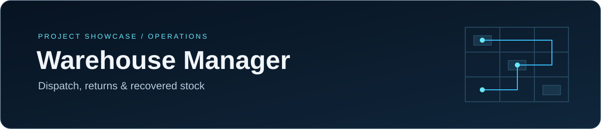

  <strong>From dispatched replacement to recovered stock—keep every unit accounted for.</strong>

  
  
  
  
  

  <a href="#the-problem">Problem</a> ·
  <a href="#the-solution">Solution</a> ·
  <a href="#app-walkthrough">Walkthrough</a> ·
  <a href="#application-architecture">Architecture</a> ·
  <a href="#data-architecture">Data model</a> ·
  <a href="#engineering-decisions">Engineering</a>

## The problem

When replacement equipment is dispatched for maintenance, the removed units are expected back. Manual follow-up made it difficult to answer three basic questions: **Has this unit returned? Where was it stored? Has it been handed over again?** Warehouse operators needed a traceable record of individual units; managers needed visibility into outstanding returns and recovered stock.

## The solution

**Warehouse Manager connects the original dispatch, each unit’s return, its warehouse location, and its next handover.** Staff can follow up on missing returns, find recovered units, and document stock issues with numbered PDF vouchers.

  <a href="img/dashboard-overview.png">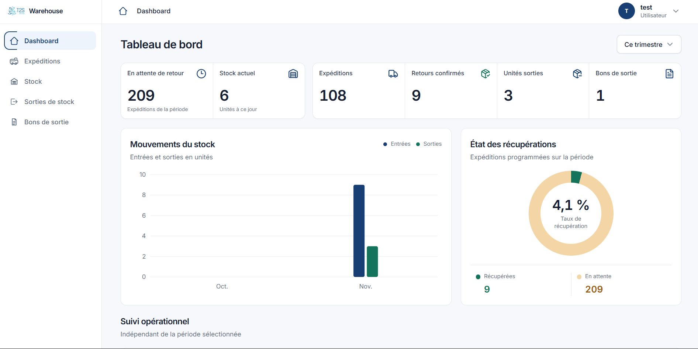</a>

*Return progress, recovered stock, and recorded movements in one operational view.*

## App walkthrough

Follow a **Touch Panel** from dispatch review to receipt, recovered stock, and a documented handover. Select any image to open it at full size; expand the supporting views for more detail.

[01 · Track returns](#01--track-outstanding-returns) → [02 · Receive units](#02--receive-and-locate-units) → [03 · Issue stock](#03--issue-stock-and-manage-paperwork)

### 01 · Track outstanding returns

Filter **Expéditions** for outstanding returns. Progress indicators and dispatch information help staff identify what needs follow-up before opening an individual unit record.

  <a href="img/dispatch-unit-status.png">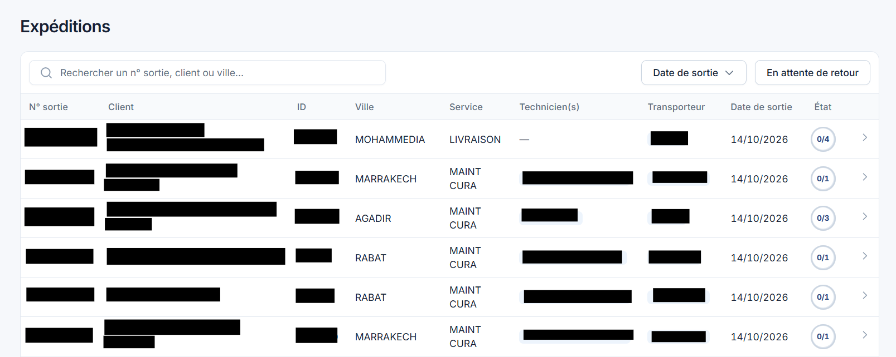</a>

*Dispatch-level progress turns an expected return into a specific follow-up task.*

### 02 · Receive and locate units

Open the dispatch and select the unit’s return-status control. Equipment, part, and unit details establish which item is being received.

  <a href="img/return-confirmation0.png">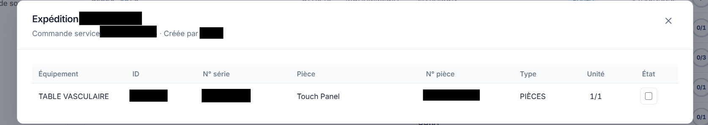</a>

The receipt form records location, condition, and optional comments or photos. Here, the Touch Panel is recorded at **ETAGE2** as **Défectueuse – réparable** (defective, repairable).

  <a href="img/return-confirmation1.png">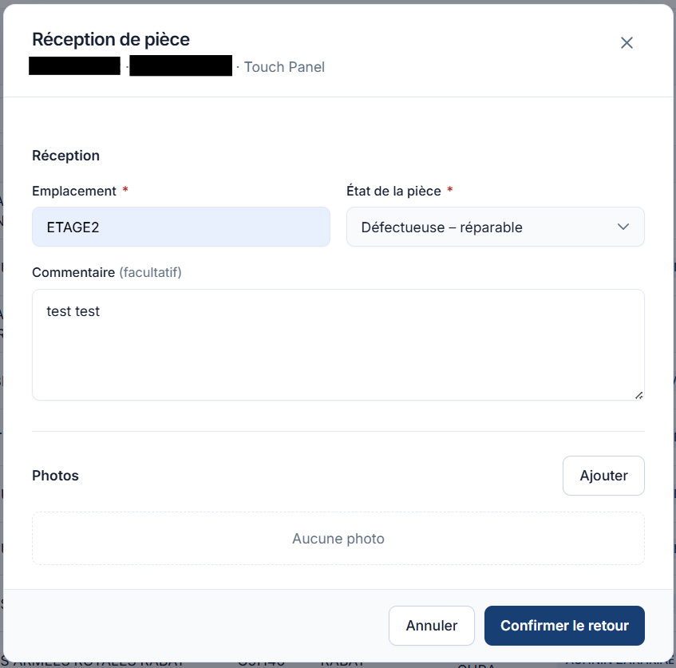</a>

*A confirmed return connects the unit’s condition and warehouse location to its original dispatch.*

<strong>See the returned part in recovered stock</strong>

The **Stock** search makes the returned part accessible for later selection.

  <a href="img/recovered-stock.png">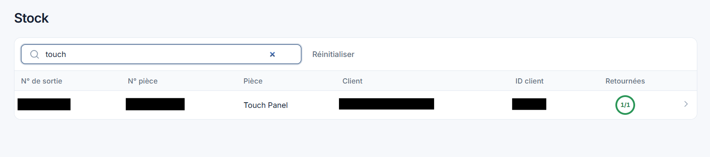</a>

### 03 · Issue stock and manage paperwork

Select an available unit and review its handover before confirmation. The preview combines recipient, collector, issue reason, original dispatch, condition, and location.

  <a href="img/stock-issue-preview.png">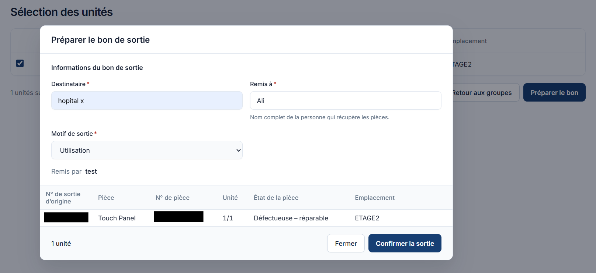</a>

*Confirmation removes the unit from available stock and creates a numbered voucher linked to its original dispatch record.*

<strong>Explore the handover record and generated voucher</strong>

**The handover record.** Voucher details keep the issued unit and handover participants together, with an original PDF download and a place to attach the signed copy later.

  <a href="img/voucher-detail.png">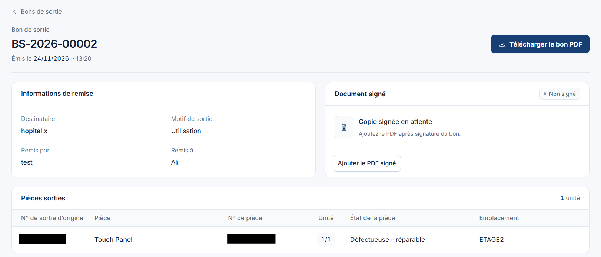</a>

**The printable document.** The generated voucher carries the issue date, recipient, part details, and quantity, with signature areas for the physical handover. The example shown is unsigned.

  <a href="img/generate-voucher.png">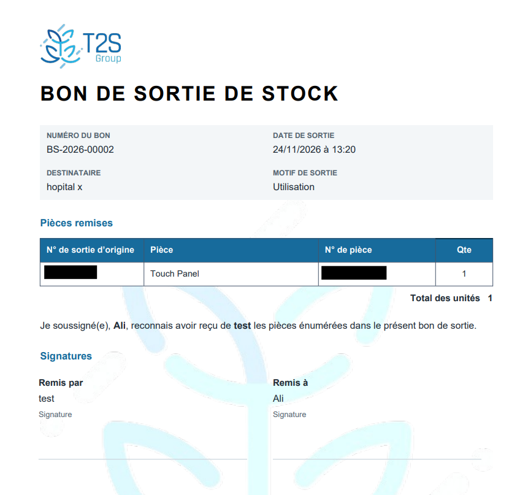</a>

After signing, the PDF copy can be attached to the voucher and retrieved separately from the original.

The **Bons de sortie** register makes previous handovers searchable by voucher number, recipient, or person. Signature filtering and date sorting help staff locate records and follow up on paperwork.

  <a href="img/voucher-section.png">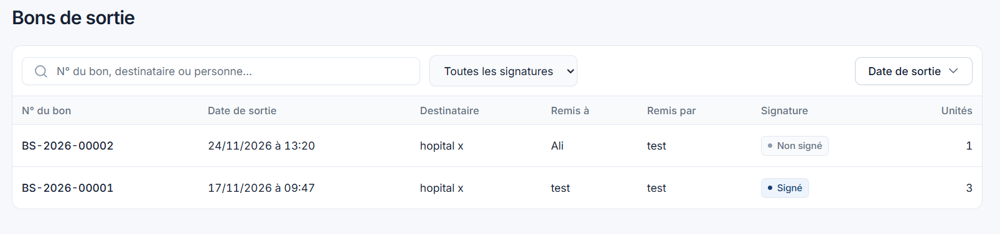</a>

*The register distinguishes filed signed copies from vouchers still awaiting them.*

## Application architecture

Django serves the interface and operational workflows. HTMX updates tables, filters, and dialogs; a batch pipeline imports OData exports, and document generation produces printable vouchers.

  <a href="img/application-architecture.svg">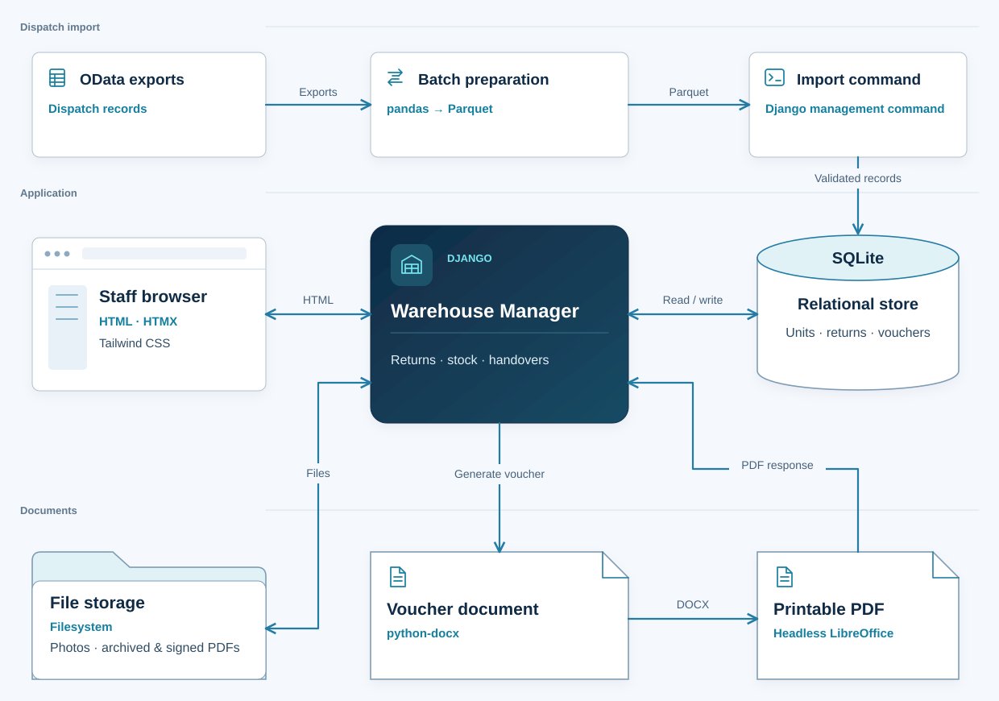</a>

*Logical application components; deployment details remain private.*

<strong>Technology responsibilities and access model</strong>

| Layer | Technologies | Responsibility |
| --- | --- | --- |
| Interface | Django templates, HTMX, Tailwind CSS | Pages, partial updates, and server-calculated SVG dashboard charts. |
| Application | Python, Django | Session authentication, forms, business rules, and persistence. Django was selected for its built-in security features. |
| Storage | SQLite, filesystem | Operational records, photos, and documents. SQLite keeps setup simple during early development. |
| Import preparation | pandas, Parquet, openpyxl | Prepare OData exports as Parquet for faster loading of large datasets; produce an Excel inspection copy. |
| Documents | python-docx, headless LibreOffice | Populate the voucher template and convert it to PDF during confirmation. |
| File validation | Pillow, pypdf | Validate uploaded images and PDFs. |

Signed-in accounts share the operational workflows. Voucher issuance and signed-copy upload record the acting account; temporary photos are scoped to their owner. Operator and manager are business roles rather than distinct application permission levels.

## Data architecture

Dispatch lines are resolved into **individually numbered units**, allowing partial returns and later stock issues to remain traceable. The schema connects those units to their return details, photo evidence, and voucher lines.

  <a href="img/data-architecture-navy.png">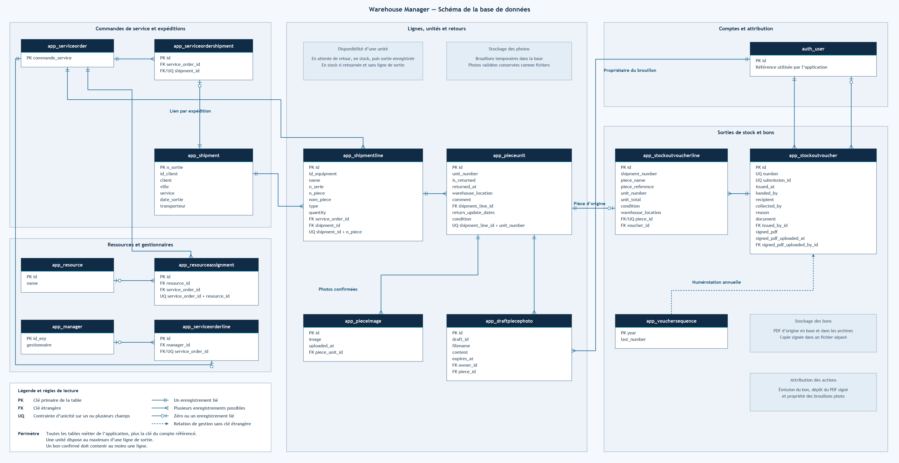</a>

*Select the diagram to inspect the relationships at full size.*

<strong>Identity, integrity, and recorded history</strong>

- **Identity:** dispatch, part reference, and unit number identify a unit. Each voucher has a unique number; a unit can have at most one issue line.
- **Lifecycle:** awaiting return → returned and available → issued. Condition is recorded separately from availability.
- **Import integrity:** ambiguous service-order mappings and quantity reductions that would leave excess numbered units require reconciliation.
- **History:** return edits retain the first return date and append edit timestamps while replacing current values. Issue lines preserve a snapshot of unit details. Vouchers record the issuer and current signed copy’s uploader and upload time.
- **Storage:** operational records, temporary photo data, and the generated voucher document are stored in the database. Saved photos, archived PDFs, and signed copies use filesystem storage.

A service order can span several dispatches; each dispatch maps to at most one service order. History covers one return-to-issue lifecycle per unit, the latest location, and the current signed attachment.

## Engineering decisions

**Preserve identity across imports.** Reloading dispatch data reuses existing numbered units so their return records remain attached to the same unit.

**Keep stock and paperwork aligned.** Availability checks, unique submission identifiers, and database transactions coordinate stock issues with voucher generation.

<strong>Implementation choices and tradeoffs</strong>

**Data preparation.** OData exports are prepared as Parquet, chosen for faster loading of large datasets.

**Database choice.** SQLite keeps configuration and early development simple. PostgreSQL is a possible replacement if database performance becomes a bottleneck.

**Imports.** Dispatch and part consolidation determines unit quantities. Ambiguous mappings or incompatible reductions stop the import for reconciliation rather than silently changing tracked identities.

**Voucher issuance.** Availability is rechecked at confirmation; PDF generation and archiving occur during the operation. Tests cover duplicate submissions and rollback. Concurrent confirmations have not been verified in the evidence review.

**Photo evidence.** Photos are staged by user and unit and validated before save. Existing-photo deletion waits until a confirmed update commits. This requires draft expiry and cleanup logic.

**Signed documents.** Original and current signed PDFs remain separately accessible. Validation and stale-request checks protect updates; signature presence relies on the uploader’s confirmation. Complete signed-copy version history is outside the current implementation.

## Testing and limitations

The **35 passing automated tests** cover imports and reloads, dashboard calculations and filters, dispatch browsing, return updates and photos, voucher issuance and rollback, signed copies, and authentication.

The application supports return follow-up, recovered-unit lookup, documented stock issues, and retrieval of signed paperwork. Its current boundaries are:

- Stock figures cover recovered units; external tracking follows recorded events and manual follow-up.
- Each unit’s recorded lifecycle ends at stock issue, with partial history rather than a complete event log.
- Imports run in batches; scheduled refresh and additional reconciliation work remain unfinished.

Operational benefits have not been measured; no reduction in losses, fraud, or processing time is claimed.

---

*This repository showcases the project. The codebase is not shared because it contains sensitive business data and related business information. Identifying details in screenshots have been redacted.*
